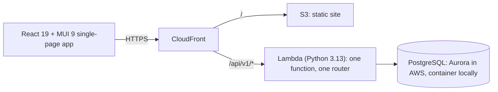

# ACME Project Tracker

A web application for tracking projects, deliverables, people's capacity and budgets, built for the
ACME coding workshop. It answers seven questions the business could not answer before:

| # | Question | Where to look |
|---|----------|---------------|
| 1 | What is the status of each project? | Dashboard · Projects |
| 2 | Which projects are at risk? | Dashboard "Needs attention" · Projects filtered by health |
| 3 | How are people allocated across projects? | Capacity · Project → Team |
| 4 | What are the key deliverables and their status? | Deliverables (table or board) · My work |
| 5 | Who is over-allocated? | Capacity · Dashboard "Workload" |
| 6 | What depends on what? | Project → Dependencies · a deliverable's linked work items |
| 7 | How much budget is consumed against plan? | Budget · Project → Budget |

The full design record, phase by phase, is in [docs/project-plan.md](docs/project-plan.md).

## Architecture



- **Frontend** ([frontend/](frontend/)): React 19, Vite, Material UI 9, react-responsive. One theme file
  with light and dark colour schemes; pages are lazy-loaded; every list keeps its filters in the URL.
- **Backend** ([backend/v1/](backend/v1/)): one Lambda with two runtime dependencies (`psycopg`, `PyJWT`).
  Entities are *declared* once (fields, filters, policy, rules) and a small engine turns each into REST
  endpoints. One database transaction per request; every change writes an audit entry in that transaction.
- **Database**: PostgreSQL, with versioned, append-only migrations applied on start-up.
- **Infrastructure** ([infra/](infra/)): Terraform. LocalStack locally, AWS in the cloud, same code.

## Run it locally

```sh
./bin/start-dev.sh                       # LocalStack + PostgreSQL + API proxy (3001) + Vite (3000)
# Read the generated admin password from the local (LocalStack) Terraform state, then load the demo data:
export SEED_ADMIN_PASSWORD=$(cd infra && AWS_ENDPOINT_URL=http://localhost.localstack.cloud:4566 \
  AWS_ENDPOINT_URL_S3=http://s3.localhost.localstack.cloud:4566 AWS_ACCESS_KEY_ID=test \
  AWS_SECRET_ACCESS_KEY=test AWS_REGION=us-east-1 terraform output -raw app_admin_password)
./bin/seed-demo.py                       # departments, people, projects, expenses (safe to re-run)
```

Open <http://localhost:3000>. After changing backend code, restart the warm Lambda containers:
`docker ps -q --filter "name=localstack-main-lambda" | xargs -r docker rm -f`.

### Demo accounts

All use the password `Demo#2026!` (the administrator's password is the Terraform output above).

| Role | Account | Can |
|------|---------|-----|
| Project manager | `alice.pm@acme.example`, `bob.pm@acme.example` | Run their projects: deliverables, links, expenses |
| Team lead | `carol.lead@acme.example` | Manage their team's capacity and leave |
| Team member | `dan.dev@acme.example`, `erin.dev@acme.example`, `frank.analyst@acme.example` | Update their own work and leave |
| Viewer | `grace.exec@acme.example` | Read everything they are allowed to see |
| Admin | `admin@acme.example` | Everything, plus users, settings and the audit log |

## Deploy to AWS

```sh
./bin/deploy-backend.sh                  # infrastructure, Lambda, database
./bin/deploy-frontend.sh                 # build and upload the site
./bin/smoke-test.sh https://<cloudfront-domain>
```

## Tests

| Suite | Command | Result (last run) |
|-------|---------|-------------------|
| Backend unit + integration, lint, security scan | `./bin/run-tests.sh backend` | 309 tests, 99% coverage |
| Frontend unit + component, lint | `./bin/run-tests.sh frontend` | 139 tests, 93% line coverage |
| End to end (Playwright, real stack) incl. accessibility | `./bin/run-e2e.sh` | 12 tests |
| Load | `./bin/load-test.py` | 120 requests, 0 errors, p95 under 400 ms locally |
| Smoke | `./bin/smoke-test.sh [site-url]` | 14 checks |
| UI review screenshots | `cd frontend && npm run screenshots -- --theme all --viewport all` | one PNG per page, viewport and mode |

Integration tests use a throwaway `acme_test` database. The end-to-end suite signs in as each role,
exercises the blocking rules from the list and the board, records an expense, retunes a setting as admin,
and runs axe accessibility checks (WCAG 2 A/AA) on the main pages in light and dark mode.

## How it behaves

- **Roles**: admin, project manager, team lead, team member, viewer. Every record comes back with what the
  caller may do to it, so the UI never guesses.
- **Capacity** is derived from work, not from percentages: a deliverable's remaining hours are reserved on
  its owner, spread over the working days up to its due date. Leave reduces availability.
- **Health** (on track / at risk / off track) is computed from schedule, budget and overdue or blocked work,
  with the reasons shown.
- **Statuses stay consistent**: linking an unfinished blocker blocks the work; finishing, unlinking or
  deleting the blocker releases it; blocked work cannot be started. The rules table is in the plan
  ("State rules").
- **Tunable without a redeploy**: thresholds, categories, working days, page sizes, token lifetimes and
  lockout limits are settings an admin edits in **Settings**; each change is in the **Audit log**.

## API

Base path `/api/v1`. Send `Authorization: Bearer <access token>`. Errors share one shape:
`{"error": {"code", "message", "details", "request_id"}}`.

| Area | Endpoints |
|------|-----------|
| Session | `POST /auth/login`, `POST /auth/refresh`, `GET/PUT /auth/me`, `POST /auth/logout-all` |
| Collections (list, create, read, update, delete) | `/users`, `/departments`, `/teams`, `/projects`, `/deliverables`, `/leaves`, `/expenses` |
| Deliverable collaboration | `/deliverables/{key}/comments`, `/comments/{id}`, `/deliverables/{key}/links` |
| Project views | `GET /projects/{key}/team`, `GET /projects/{key}/dependencies` |
| Reports | `GET /reports/summary`, `/reports/capacity`, `/reports/budget` |
| Search | `GET /search?q=` |
| Admin | `GET/PUT/DELETE /settings/{key}`, `GET /audit-log` |
| System | `GET /health`, `GET /meta` |

Lists accept `q`, `sort` (prefix `-` for descending), `limit`, `offset` and per-collection filters
(for example `/projects?health=amber,red`, `/deliverables?overdue=true&owner_id=me`). Projects and
deliverables can be addressed by key (`/projects/WEB`, `/deliverables/WEB-2`).

## Security

- Passwords hashed with scrypt; short-lived access tokens and rotating refresh tokens; "sign out everywhere".
- Repeated failed sign-ins lock the account for a while (both limits are settings).
- Authorization is enforced in the API on every request; records the caller cannot see behave as not found.
- SQL is parameterised throughout; request bodies are size-limited; logs redact secrets and tokens.
- API responses are `no-store` and `nosniff`; the site is served with CloudFront's security headers policy.
- Secrets (database password, token signing key, admin password) come from the environment only.

## Decisions and trade-offs

| Decision | Why | Cost |
|----------|-----|------|
| One Lambda and a declarative CRUD engine | Little code per entity, uniform behaviour and tests | Cold starts; one deployable unit |
| Health, progress, capacity computed on read | Never stale, no background jobs | Recomputed per request (fine at this size) |
| Refresh token in `localStorage` | Sessions survive reloads without cookies or CSRF handling | Exposed to script injection; mitigated by short access tokens and React's escaping |
| Playwright instead of the planned Cypress | One tool for end-to-end tests and the screenshot review | Chromium download (about 130 MB) |
| Statuses kept consistent by the API | Lists, health and capacity can trust them | A few actions are refused until their cause is fixed |

## Known gaps

- No email notifications, file attachments, custom statuses or holiday calendar. The plan describes where
  each one plugs in (audit log, settings, search providers).
- Work blocked by a deliverable in a *cancelled* project stays blocked until someone unlinks it.
- The dependency graph draws columns by depth; very large graphs scroll rather than re-flow.
- Single currency, single organisation.
