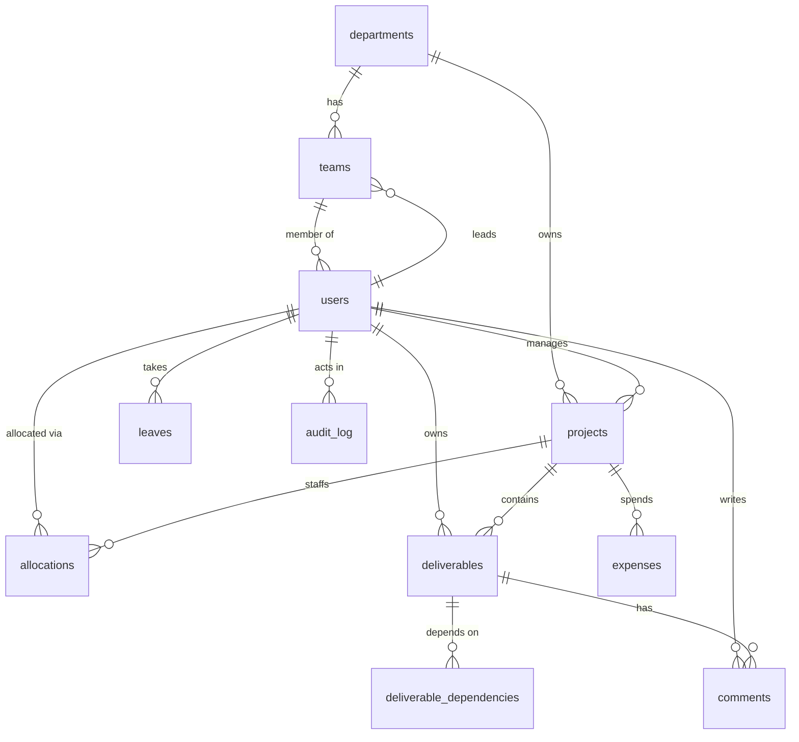

# ACME Project Tracker — Design & Delivery Plan

> Status: **v3, approved**. Phase 0 implemented; open questions resolved (§12).

**Contents**
1. [Core Features & Use Cases](#1-core-features--use-cases)
2. [Roles & Permissions](#2-roles--permissions)
3. [Core Business Entities](#3-core-business-entities)
4. [Entities, Tables & Endpoints](#4-entities-tables--endpoints)
5. [Computed Business Models](#5-computed-business-models)
6. [HTTP API Conventions](#6-http-api-conventions)
7. [Configuration, Logging & Shutdown](#7-configuration-logging--shutdown)
8. [Code Structure & Libraries](#8-code-structure--libraries)
9. [Phase Plan (0–5)](#9-phase-plan-05)
10. [Design Decisions](#10-design-decisions)
11. [Future Extensions (designed for, not built)](#11-future-extensions-designed-for-not-built)
12. [Resolved Questions](#12-resolved-questions)

---

## 1. Core Features & Use Cases

### 1.1 Features

| # | Feature | Answers |
|---|---------|---------|
| F1 | **Sign-in & sessions**: email/password login, JWT access + refresh, logout everywhere | — |
| F2 | **Role-based access**: 5 roles, checked centrally in the API and mirrored in the UI | — |
| F3 | **Organization**: departments, teams, team leads, people | — |
| F4 | **Projects**: status, priority, dates, budget, manager; computed progress and health | Q1, Q2 |
| F5 | **Deliverables**: owner, status, due date, estimate, progress; "My work" view | Q4 |
| F6 | **Dependencies**: deliverable → depends-on chains with cycle protection | Q6 |
| F7 | **Comments** on deliverables | — |
| F8 | **Allocations**: people × projects × % × date range | Q3 |
| F9 | **Capacity & leave**: weekly capacity, planned leave, utilization, over-allocation | Q5 |
| F10 | **Budget**: planned budget vs. categorized expenses | Q7 |
| F11 | **Dashboard & reports**: KPIs, at-risk list, capacity view, budget burn | Q1–Q7 |
| F12 | **Search & filter**: `q` text search and filters on every list, plus a global search box | — |
| F13 | **Admin console**: users and roles, runtime settings (no redeploy), audit trail | — |
| F14 | **Responsive UI**: MUI with `react-responsive` (tables become cards on mobile) | — |

Business questions: **Q1** project status · **Q2** at-risk projects · **Q3** resource allocation · **Q4** deliverable status · **Q5** over-allocated people · **Q6** dependency chain · **Q7** budget consumed vs planned.

### 1.2 Use cases by actor

| Actor | Use cases |
|-------|-----------|
| **Everyone (signed in)** | UC1 Log in / stay signed in / log out everywhere · UC2 View & edit own profile, change password · UC3 Browse/search/filter projects, deliverables, people · UC4 View dashboard |
| **Admin** | UC5 Create users, assign roles, deactivate, reset password · UC6 Manage departments & teams, appoint team leads · UC7 Tune system settings at runtime · UC8 Review audit trail · *(plus everything below)* |
| **Project Manager** | UC9 Create/edit/close own projects · UC10 Plan deliverables (owner, due date, estimate) · UC11 Link deliverable dependencies · UC12 Allocate people to own projects · UC12b Restrict a project's visibility · UC13 Record expenses, track burn · UC14 Monitor health & act on risk reasons |
| **Team Lead** | UC15 Adjust weekly capacity of own team members · UC16 Record/edit planned leave for own team · UC17 See team availability & over-allocation · UC17b Allocate own team members to projects · *(plus Team Member use cases)* |
| **Team Member** | UC18 See "My work" · UC19 Update status/progress of own deliverables · UC20 Comment on deliverables · UC21 Record own planned leave |
| **Viewer** | UC22 Read-only access to projects, deliverables, reports |

---

## 2. Roles & Permissions

### 2.1 Roles

One role per user (the highest needed).

| Role | Who | In one line |
|------|-----|-------------|
| `admin` | PMO / platform owner | Everything, including users, org structure, settings, audit |
| `project_manager` | Runs projects | Full control of **projects they manage** and everything inside them |
| `team_lead` | Leads a team | Team Member rights + manages **own team's capacity and leave** |
| `team_member` | Contributor | Updates **own deliverables**, comments, records own leave |
| `viewer` | Stakeholder / exec | Read-only |

"Own" is resolved from data, not from extra tables:

| Scope | Rule |
|-------|------|
| own project | `projects.manager_id = me` |
| own team | `teams.lead_id = me` (the user must have role `team_lead`) |
| own deliverable | `deliverables.owner_id = me` |
| own leave / comment | `leaves.user_id = me` / `comments.author_id = me` |
| own team member | `users.team_id` ∈ teams I lead |

### 2.2 Permission matrix

C/R/U/D = create/read/update/delete. "R" means read for all signed-in users.

| Resource | admin | project_manager | team_lead | team_member | viewer |
|----------|:-----:|:---------------:|:---------:|:-----------:|:------:|
| users | CRUD | R | R · U `weekly_capacity_hours` of own team | R | R |
| departments, teams | CRUD | R | R | R | R |
| leaves | CRUD | R | CRUD own team + self | CRUD self | R |
| projects | CRUD | C · R · UD own | R ¹ | R ¹ | R ¹ |
| deliverables | CRUD | CRUD in own projects | R · U `status`,`progress_pct` of own | same as TL | R |
| dependencies | CRUD | CRUD in own projects | R | R | R |
| comments | CRUD | C · UD own · D any in own projects | C · UD own | C · UD own | R |
| allocations | CRUD | CRUD in own projects | R · CRUD for own team members | R | R |
| expenses | CRUD | CRUD in own projects | R | R | R |
| reports, search, meta | R | R | R | R | R |
| settings, audit log | RU / R | — | — | — | — |

### 2.3 RBAC rules

- All routes except `GET /health`, `POST /auth/login` and `POST /auth/refresh` need a valid access token (otherwise 401).
- Each resource definition declares its own policy. One `authorize()` call runs before every handler; a denial returns 403 `forbidden`.
- The current user is loaded from the DB on every request, so role changes and deactivations take effect immediately.
- **No privilege escalation:**
  - Only admins can change `role`.
  - Users can't change their own role or deactivate themselves.
  - The last active admin can't be demoted, deactivated or deleted.
  - A PM creating a project becomes its manager and can't hand it to someone else.
- No self-registration. The first admin is created from deployment config (see §7.1).
- The UI gets the same rules through `GET /auth/me` (a permissions map) and hides or disables actions the user can't take.

---

## 3. Core Business Entities

### 3.1 Tables (12)

| # | Table | Entity | Kind | Phase |
|---|-------|--------|------|-------|
| 1 | `departments` | Department | Org | 1 |
| 2 | `users` | User = **person + login** | Org | 1 |
| 3 | `teams` | Team (with lead) | Org | 2 |
| 4 | `leaves` | Planned leave | Capacity | 2 |
| 5 | `projects` | Project | Delivery | 1 |
| 6 | `deliverables` | Deliverable | Delivery | 1 |
| 7 | `deliverable_dependencies` | Dependency edge | Delivery | 3 |
| 8 | `comments` | Deliverable comment | Delivery | 3 |
| 9 | `allocations` | Allocation | Capacity | 2 |
| 10 | `expenses` | Expense | Budget | 3 |
| 11 | `app_settings` | Runtime setting override | System | 0 |
| 12 | `audit_log` | Audit entry | System | 1 |
| + | `schema_migrations` | Applied migration versions | Infra | 0 |

**Changes since v1:**
- `team_members` merged into `users`. A person who never logs in has no password.
- `refresh_tokens` replaced by a `users.token_version` column.
- `project_updates` dropped (comments and computed health cover it).
- Added: `leaves`, `comments`, `app_settings`.

### 3.2 ER diagram



Every table has `id BIGINT IDENTITY PRIMARY KEY` (except the dependency edge, which has a composite key), plus `created_at` and `updated_at`.

---

## 4. Entities, Tables & Endpoints

Base path `{API_BASE}/api/v1`. "CRUD" below means these five endpoints, all handled by one generic engine:
`GET /x` (list) · `POST /x` (create → 201) · `GET /x/{id}` · `PUT /x/{id}` (partial update) · `DELETE /x/{id}` (→ 204).

### 4.1 Auth & system

| Method | Path | Access | Purpose |
|--------|------|--------|---------|
| GET | `/health` | public | Liveness + DB check |
| POST | `/auth/login` | public | `{email, password}` → `{access_token, refresh_token, expires_in, user}` |
| POST | `/auth/refresh` | public | `{refresh_token}` → new token pair |
| GET | `/auth/me` | signed in | Profile + role + permissions map |
| PUT | `/auth/me` | signed in | Update own name; change password (`current_password` required) |
| POST | `/auth/logout-all` | signed in | Bump `token_version` and invalidate every session. Single-device logout is client-side. |
| GET | `/meta` | signed in | Dropdown values and public settings: roles, statuses, priorities, expense categories, leave types, currency, app name |
| GET | `/search?q=` | signed in | Top matches across projects, deliverables, people |

### 4.2 Departments — `departments`

| Field | Type / rule |
|-------|-------------|
| `name` | text ≤100, required, unique |
| `code` | text ≤10, required, unique, upper-case (e.g. `ENG`) |
| `description` | text, optional |

Endpoints: **CRUD** `/departments`. Filter: `q`. Delete returns 409 while teams or projects reference it.

### 4.3 Users (people) — `users`

| Field | Type / rule |
|-------|-------------|
| `email` | unique, lower-cased, valid format |
| `name` | text ≤200, required |
| `role` | `admin` · `project_manager` · `team_lead` · `team_member` · `viewer` (default `team_member`) |
| `job_title` | text, optional |
| `team_id` | → teams, optional (department comes from the team) |
| `weekly_capacity_hours` | 0–168, default from setting `capacity.default_weekly_hours` |
| `is_active` | bool, default true |
| `password` | write-only, min length from setting; stored as `password_hash` (scrypt). Empty means the person can't log in. |
| *hidden* | `password_hash`, `token_version` · *read-only* `last_login_at` |

Endpoints:
- **CRUD** `/users`. Create and delete are admin-only. On update, a team lead may change only `weekly_capacity_hours`, and only for their own team.
- Filters: `q` (name/email), `role`, `team_id`, `department_id`, `is_active`.
- Rules:
  - Changing role, password or `is_active` bumps `token_version`, which forces a re-login.
  - Delete returns 409 if the user is referenced; deactivate instead.

### 4.4 Teams — `teams`

| Field | Type / rule |
|-------|-------------|
| `department_id` | → departments, required |
| `name` | required, unique per department |
| `lead_id` | → users, optional; the user must have role `team_lead` |

Endpoints: **CRUD** `/teams` (admin writes). Filters: `q`, `department_id`. Members: `GET /users?team_id=`.

### 4.5 Leaves — `leaves`

| Field | Type / rule |
|-------|-------------|
| `user_id` | → users, required |
| `start_date`, `end_date` | required, end ≥ start (full days) |
| `type` | one of setting `leaves.types` (default: vacation, sick, training, other) |
| `note` | text, optional |

Endpoints: **CRUD** `/leaves`. Filters: `user_id`, `team_id`, `from`, `to` (overlap). Rule: a person's leaves can't overlap (400).

### 4.6 Projects — `projects`

| Field | Type / rule |
|-------|-------------|
| `code` | unique, required (e.g. `PRJ-001`) |
| `name` | ≤200, required · `description` optional |
| `department_id` | → departments, required |
| `manager_id` | → users with role `project_manager` or `admin` (a PM's own id by default) |
| `status` | `planning` · `active` · `on_hold` · `completed` · `cancelled` |
| `priority` | `low` · `medium` · `high` · `critical` |
| `start_date`, `end_date` | end ≥ start |
| `planned_budget` | ≥ 0 |
| `visibility` | `inherit` (default) · `everyone` · `members`; set by the project's PM or an admin |
| `completed_at` | auto-set when status becomes `completed` |
| *computed* | `progress_pct`, `budget_spent`, `budget_burn_pct`, `deliverable_counts`, `overdue_count`, `health`, `health_reasons` |

Endpoints:
- **CRUD** `/projects`.
- Filters: `q` (code/name/description), `status` (multi), `priority`, `department_id`, `manager_id` (`me`), `health` (multi, e.g. `health=amber,red` for **Q2**), `end_from`/`end_to`.
- Delete cascades to deliverables, allocations and expenses (the UI confirms with counts first).

### 4.7 Deliverables — `deliverables`

| Field | Type / rule |
|-------|-------------|
| `project_id` | → projects, required |
| `name` | ≤200, required · `description` optional |
| `owner_id` | → active user, optional |
| `status` | `not_started` · `in_progress` · `blocked` · `completed` |
| `priority` | `low` · `medium` · `high` · `critical` ("key deliverables" = high/critical) |
| `due_date` | optional |
| `estimated_hours` | ≥ 0, optional (used to weight progress) |
| `progress_pct` | 0–100 |
| `completed_at` | auto |
| *computed* | `depends_on_ids`, `is_overdue` |

Endpoints:
- **CRUD** `/deliverables`.
- Filters: `q`, `project_id`, `owner_id` (`me` gives "My work"), `status` (multi), `priority`, `due_from`/`due_to`, `overdue=true`.
- Rules:
  - `completed` sets `progress_pct = 100` and `completed_at = now`; leaving `completed` clears `completed_at`.
  - A deliverable can't be completed while any upstream dependency is incomplete (400 lists the blockers).

### 4.8 Dependencies — `deliverable_dependencies` (sub-resource)

| Field | Type / rule |
|-------|-------------|
| `deliverable_id`, `depends_on_id` | composite PK; same project; not self; no cycles |

| Method | Path | Purpose |
|--------|------|---------|
| GET | `/deliverables/{id}/dependencies` | Full chain: `upstream` and `downstream`, recursive, with depth (**Q6**) |
| POST | `/deliverables/{id}/dependencies` | `{depends_on_id}` → 201. A cycle returns 400; a duplicate returns 409. |
| DELETE | `/deliverables/{id}/dependencies/{depends_on_id}` | 204 |

### 4.9 Comments — `comments`

| Field | Type / rule |
|-------|-------------|
| `deliverable_id` | → deliverables (cascade) |
| `author_id` | → users, set from token |
| `body` | 1–5000 chars |

| Method | Path | Purpose |
|--------|------|---------|
| GET | `/deliverables/{id}/comments` | Paged, newest first |
| POST | `/deliverables/{id}/comments` | Add comment (everyone except viewer) |
| PUT | `/comments/{id}` | Edit (author only) |
| DELETE | `/comments/{id}` | Author, the project's PM, or admin |

### 4.10 Allocations — `allocations` *(removed after review; see Phase 2 status)*

| Field | Type / rule |
|-------|-------------|
| `project_id` | → projects, required |
| `user_id` | → active users, required |
| `allocation_pct` | > 0 and ≤ 100 (% of the person's weekly capacity) |
| `start_date` | required · `end_date` optional (open-ended), ≥ start |

Endpoints: **CRUD** `/allocations`. Filters: `project_id`, `user_id`, `team_id`, `active_on`, `from`/`to`. Rules: the same person can't have overlapping allocations on the same project; a team lead may allocate only members of teams they lead (to any project they can see).

### 4.11 Expenses — `expenses`

| Field | Type / rule |
|-------|-------------|
| `project_id` | → projects, required |
| `amount` | > 0 |
| `category` | one of setting `budget.expense_categories` |
| `spent_on` | date, required · `description` optional |
| `created_by` | set from token |

Endpoints: **CRUD** `/expenses`. Filters: `project_id`, `category`, `from`/`to`.

### 4.12 Reports

| Method | Path | Returns | Answers |
|--------|------|---------|---------|
| GET | `/reports/summary` | Projects by status and health, deliverables by status, overdue count, total planned vs spent, over-allocated people count | Q1 Q2 Q4 Q7 |
| GET | `/reports/capacity?from&to&team_id&department_id` | Per person: capacity, leave, available and allocated hours, utilization %, over-allocated flag, per-project breakdown | Q3 Q5 |
| GET | `/reports/budget?project_id&department_id` | Planned vs spent per project, by category and by month, burn % | Q7 |

### 4.13 Admin

| Method | Path | Purpose |
|--------|------|---------|
| GET | `/settings` | All settings: key, value, default, type, limits, description, last changed by/at |
| PUT | `/settings/{key}` | `{value}`, validated against the registry; takes effect without redeploy |
| DELETE | `/settings/{key}` | Reset to default |
| GET | `/audit-log` | Filters: `entity`, `entity_id`, `actor_id`, `action`, `from`/`to` |

**Total:**
- 8 generic CRUD resources × 5 = 40 routes, all from one engine.
- 22 hand-written routes: 8 auth/system, 3 dependency, 4 comment, 3 report, 4 admin.

`audit_log` columns: `actor_id`, `action` (create/update/delete), `entity`, `entity_id`, `changes` (JSONB before/after of changed fields), `request_id`, `created_at`. It is written by the CRUD engine **in the same transaction** as the change.

---

## 5. Computed Business Models

All thresholds below are **runtime settings** (§7.2). Every result is computed on read, so nothing goes stale.

| Model | Definition |
|-------|-----------|
| **Status category** | Business logic works on categories (`todo`, `active`, `blocked`, `done`), mapped from statuses by one function. Today the mapping is 1:1. |
| **Deliverable overdue** | `due_date < today` and category ≠ `done` |
| **Project progress %** | Mean of deliverable `progress_pct`, weighted by `estimated_hours` (equal weights when missing) |
| **Schedule elapsed %** | `(today − start_date) / (end_date − start_date)`, clamped 0–100 |
| **Budget burn %** | `SUM(expenses.amount) / planned_budget` |
| **Health** (active and on-hold projects only) | 🔴 **Red** if any of: past `end_date`; burn > 100 %; a deliverable overdue > `health.red_overdue_days`; elapsed − progress > `health.red_schedule_gap_pct`.<br>🟠 **Amber** if any of: an overdue or blocked deliverable; burn − progress > `health.amber_budget_gap_pct`; elapsed − progress > `health.amber_schedule_gap_pct`.<br>🟢 **Green** otherwise.<br>Returned with `health_reasons[]`. |
| **Capacity** (window `from`–`to`) | `hours_per_day = weekly_capacity_hours / len(capacity.working_days)`<br>`capacity = hours_per_day × working days in window`<br>`available = capacity − hours_per_day × leave days in window`<br>`allocated = Σ allocation_pct/100 × hours_per_day × overlapping working days`<br>`utilization = allocated / available`<br>**Over-allocated** if utilization > `capacity.overallocation_threshold_pct` |

Planned leave lowers availability but not commitments. Leave can therefore *cause* over-allocation, and the team lead sees it, which is the point of the team lead role.

---

## 6. HTTP API Conventions

| Topic | Convention |
|-------|-----------|
| Format | JSON in/out, UTF-8, ISO dates (`YYYY-MM-DD`) and timestamps (UTC) |
| Auth | `Authorization: Bearer <access_token>` |
| Paths | Plural, kebab-case (`/audit-log`), integer ids |
| Update | `PUT` = partial update; unknown fields return 400 |
| List response | `{"data": [...], "total": 42, "limit": 25, "offset": 0}` |
| List params | `q` · `sort=-due_date,name` · `limit` (≤ `api.max_page_size`) · `offset` · multi-value `status=a,b` · ranges `*_from`/`*_to` · `me` alias for user ids |
| Errors | `{"error": {"code", "message", "details", "request_id"}}`; `details` maps field → message |
| Status codes | 200 OK · 201 Created · 204 No Content · 400 `bad_request`/`validation_error` · 401 `unauthorized`/`token_expired` · 403 `forbidden` · 404 `not_found` · 409 `conflict` (duplicate / in use) · 500 `internal_error` · 503 `unavailable` (DB down / timeout) |
| Tracing | Every response carries `X-Request-Id` (the Lambda request id) |
| Limits | Request body ≤ 1 MB; text fields have max lengths |

---

## 7. Configuration, Logging & Shutdown

### 7.1 Configuration: three layers, one registry

| Layer | Where | Changed by | Holds |
|-------|-------|------------|-------|
| 1. Code defaults | `app/config.py` registry: key, type, default, min/max/choices, description, `public` flag | Developer | Default for every tunable setting |
| 2. Environment | Lambda env (Terraform) | Deploy | **Bootstrap and secrets only:** `POSTGRES_*`, `IS_LOCAL`, `JWT_SECRET`, `LOG_LEVEL` (initial), `SETTINGS_CACHE_SECONDS` (default 30), `ADMIN_EMAIL`/`ADMIN_PASSWORD` (first admin) |
| 3. Runtime overrides | `app_settings` table (`key`, `value` JSONB, `updated_by`, `updated_at`) | **Admin, from the console** | Any registry setting. Validated, audit-logged, cached per Lambda container for `SETTINGS_CACHE_SECONDS`, so a change reaches every container within ~30 s **without redeploying**. |

Frontend config:
- Build-time: `VITE_API_URL`, which the existing `generate-env.sh` writes.
- Runtime: everything else comes from `GET /meta`, so admin changes show up in the UI without a rebuild.

**Initial runtime settings:**

| Key | Default | Effect |
|-----|---------|--------|
| `app.name` | `ACME Project Tracker` | UI title |
| `logging.level` | `INFO` | Log level, switchable live (e.g. `DEBUG` while troubleshooting) |
| `auth.access_token_minutes` | 15 | Access token lifetime |
| `auth.refresh_token_days` | 7 | Refresh token lifetime |
| `auth.password_min_length` | 8 | Password policy |
| `api.default_page_size` / `api.max_page_size` | 25 / 200 | Paging |
| `db.statement_timeout_ms` | 10000 | Fail fast instead of hanging |
| `health.amber_schedule_gap_pct` / `health.red_schedule_gap_pct` | 10 / 25 | Health rules |
| `health.amber_budget_gap_pct` | 15 | Health rules |
| `health.red_overdue_days` | 7 | Health rules |
| `capacity.working_days` | `[1,2,3,4,5]` (Mon–Fri) | Capacity maths |
| `capacity.default_weekly_hours` | 40 | New users |
| `capacity.overallocation_threshold_pct` | 100 | Over-allocation flag |
| `capacity.default_window_days` | 28 | Capacity report window |
| `budget.currency` | `USD` | Single currency for all amounts |
| `projects.default_visibility` | `everyone` | What `visibility = inherit` means: `everyone` or `members` (manager, allocated people, deliverable owners) |
| `budget.expense_categories` | labor, software, hardware, services, travel, other | Expense validation and dropdowns |
| `leaves.types` | vacation, sick, training, other | Leave validation and dropdowns |

Admin console (Settings page): settings grouped by prefix, an input matching each type, inline validation, "modified" badges, per-setting reset, and who changed it and when.

### 7.2 Logging

- **Format:** JSON lines to stdout, which Lambda sends to CloudWatch.
  - Fields: `ts`, `level`, `logger`, `msg`, `request_id`, `user_id`, `method`, `path`, `status`, `duration_ms`.
- **Per request:** exactly one access-log line, plus `ERROR` with a stack trace for unhandled exceptions.
- **Level:** controlled by `logging.level`, live.
- **Redaction:** `password`, `current_password`, `*_token` and the `Authorization` header are never logged.
- **Frontend:** a central error handler and `ErrorBoundary`. Users see a friendly message with the `request_id` so issues can be traced in the logs.

### 7.3 Graceful shutdown & reliability

| Concern | Approach |
|---------|----------|
| Partial writes | Each request runs in **one DB transaction**: commit on success, roll back on any error. An interrupted invocation never leaves half-written data. |
| Hanging requests | `statement_timeout` (setting) keeps requests well under the Lambda timeout; a timeout returns a clean 503. |
| Connection reuse | One connection per warm container, checked and transparently re-opened if broken (already implemented). |
| Shutdown | A `SIGTERM` handler closes the DB connection and flushes logs. *Lambda only sends SIGTERM to the runtime when an extension is registered. Otherwise the container is frozen and discarded, and the transactions above keep data safe.* |
| Frontend | `AbortController` cancels in-flight requests on navigation. A token refresh runs once even if many requests hit 401 at the same time, then the original requests are retried. |

---

## 8. Code Structure & Libraries

### 8.1 Backend — `backend/v1` (Python 3.13, 2 dependencies: `psycopg[binary]`, `PyJWT`)

```
backend/v1/
├── function.py        # Lambda entry: handler(event, context) → app.http.dispatch
├── requirements.txt
├── app/
│   ├── config.py      # env bootstrap + settings registry + DB-override cache
│   ├── log.py         # JSON formatter, request context, redaction
│   ├── db.py          # connection, transaction(), SIGTERM hook
│   ├── migrations.py  # ordered SQL migrations + runner (schema_migrations)
│   ├── http.py        # Request/Response, ApiError, router, paging/sort parsing
│   ├── validation.py  # field types, coercion, cross-field rules
│   ├── auth.py        # scrypt hashing, JWT issue/verify, current user
│   ├── rbac.py        # roles, ownership scopes, authorize()
│   ├── crud.py        # generic list/get/create/update/delete + audit writes
│   ├── resources.py   # one declarative definition per entity: fields, filters, search, policy, hooks
│   ├── services/      # health.py · capacity.py · dependencies.py · reports.py · search.py
│   └── routes.py      # route table: auth, crud, sub-resources, reports, admin
└── tests/             # unit/ (no DB) · integration/ (local Postgres)
```

Principles:
- An entity is **declared once** in `resources.py`; the generic engine does the rest.
- Custom behaviour lives only in small hooks and services.
- No ORM: SQL is parameterized through `psycopg.sql`.
- Type hints and docstrings everywhere (repo convention).

Existing prototype code (router, validation engine, error envelope, DB layer) is **reused and moved** into this layout, not rewritten.

### 8.2 Frontend — `frontend/src` (React 19 + Vite 7)

```
src/
├── main.jsx · App.jsx     # providers (theme, auth, router), lazy-loaded routes
├── theme.js               # MUI theme: palette, typography, component defaults
├── api/                   # client.js (fetch, auth header, refresh, error normalization) + one file per domain
├── auth/                  # AuthProvider, RequireAuth, usePermission (can(action, resource, record))
├── components/            # AppShell, ResponsiveList (DataGrid ↔ cards), FormDialog, ConfirmDialog,
│                          # StatusChip, HealthChip, FilterBar, EmptyState, ErrorBoundary
├── hooks/                 # useApi, useListQuery (filters ↔ URL), useMeta
└── features/              # dashboard · projects · deliverables · people · teams · leaves · budget · admin
```

Pages: Login · Dashboard · Projects (list → detail tabs: Overview, Deliverables, Dependencies, Team, Budget) · My Work · People & Teams (team lead: capacity and leave) · Capacity · Admin (Users, Departments & Teams, Settings, Audit log) · Profile.

### 8.3 Material UI stack (install and build verified on this VDI with React 19)

| Package | Version | Use |
|---------|---------|-----|
| `@mui/material`, `@emotion/react`, `@emotion/styled` | 9.6 / 11.14 | Core components and theming |
| `@mui/icons-material` | 9.6 | Icons |
| `@mui/x-data-grid` (MIT) | 9.18 | Sortable, paginated, server-side tables |
| `@mui/x-charts` (MIT) | 9.18 | Dashboard charts |
| `@mui/x-date-pickers` + `dayjs` | 9.18 / 1.11 | Date inputs |
| `react-responsive` | 10.0 | Required by spec: layout switches (table ↔ cards, drawer ↔ bottom nav, full-screen dialogs) |
| `react-router-dom` | 7.18 | Routing |
| `prop-types` | 15.8 | Repo convention |
| `@fontsource/roboto` | 5.3 | Self-hosted font (no CDN dependency) |
| Dev: `vitest`, `@testing-library/react` (+`jest-dom`, `user-event`), `jsdom`, `msw`, `cypress` | — | Unit, component, API-mock and E2E tests |

The bundle is about 500 kB+ with grid and charts, so routes are lazy-loaded (`React.lazy`) to keep first load small.

---

## 9. Phase Plan (0–5)

Every phase ends with:
1. Working locally **and** in AWS (`deploy-backend.sh` + `deploy-frontend.sh`).
2. Tests for what was built.
3. A commit.
4. The acceptance check passing.

### Phase 0 — Foundation (runs end to end, no business code)

- [x] Lambda dependency install fixed (`start-dev.sh` installs Python 3.13 manylinux wheels; vendored deps git-ignored)
- [x] Restructure into `app/` modules; move the reusable engine; strip domain definitions
- [x] `config.py` (registry + env + `app_settings` cache) · `log.py` (JSON, request id, redaction) · `db.py` (transaction per request, SIGTERM hook, statement timeout)
- [x] `migrations.py` + `schema_migrations` + migration `001` (`app_settings`)
- [x] Service renamed to `backend/v1`; router accepts both `/x` (local proxy) and `/api/v1/x` (CloudFront)
- [x] `bin/proxy-server.js` forwards `Authorization` and exposes `X-Request-Id`
- [x] Terraform: `JWT_SECRET` (`random_password`) and admin bootstrap vars added to Lambda env
- [x] Frontend: MUI stack installed · theme · AppShell (responsive drawer / bottom nav) · router with lazy routes · `api/client.js` · status page showing API/DB health
- [x] Tooling: pytest + coverage, ruff; vitest + RTL + msw; ESLint (PropTypes declared on every component; no lint rule, as `eslint-plugin-react` does not support ESLint 10); `bin/run-tests.sh`
- [x] CloudFront: SPA deep links via a CloudFront Function instead of a distribution-wide 404→index.html (which also swallowed API 404s)
- [x] First AWS deploy (Aurora is slow to provision, so this de-risks it early)

✅ **Done when** `localhost:3000` and the CloudFront URL both show the app shell with "API ✓ DB ✓", `pytest` and `npm test` pass, and logs in CloudWatch are JSON with request ids.

### Phase 1 — MVP: sign-in, projects, deliverables (Q1, Q4)

> **Status: implemented.**
> - Each record in a response carries a `permissions` object (`update`, `delete`, `editable_fields`), so the UI hides exactly what the API would refuse.
> - **Keys (added after review):** projects have a 3-6 character key (`ENG`, `SRE`) that is fixed after creation; deliverables are `<KEY>-<n>` (`ENG-12`), numbered per project from a counter that is never reused. URLs and search accept keys.
> - **Deliverable page is Jira-style:** content on the left (title, description, acceptance criteria, linked work items, comments), metadata on the right (status, assignee, reporter, priority, due date, estimate, progress), edited in place by whoever has permission.
> - **Pulled forward from Phase 3** because that page needs them: comments, and links between deliverables (blocks / is blocked by / relates to; circular blocks rejected; a deliverable cannot be completed while an unfinished one blocks it). Phase 3 keeps the project-level dependency graph view.
> - Deliverable due dates must fall within the project's dates (and project dates cannot exclude existing deliverables).
> - No separate last-admin guard: admins can't demote, deactivate or delete themselves, and every request comes from an active admin, so at least one active admin always remains.

- Backend:
  - Migrations for `departments`, `users`, `projects`, `deliverables`, `audit_log`.
  - Generic CRUD engine with search, filters, sort and paging.
  - Audit writes.
- Auth & access:
  - login, refresh, me, logout-all; `token_version`; first-admin bootstrap.
  - `rbac.py` with the **full 5-role policy** for these entities.
  - `GET /meta`; `GET/PUT/DELETE /settings` (API only).
- Business rules: deliverable completion (progress 100, `completed_at`).
- `bin/seed-demo.py` creates demo data **through the REST API**, so it works locally and in the cloud.
- UI:
  - Login, role-aware navigation.
  - Projects list (search, status filter) → detail with Deliverables tab.
  - My Work; Users and Departments admin.
  - Create/edit dialogs with field validation; confirm-delete; snackbars; loading skeletons.
- Tests: validation, auth/token, RBAC matrix for these entities, CRUD integration.

✅ **Done when** admin, PM, team member and viewer each log in and see exactly what the matrix allows. API calls outside it return 403.

### Phase 2 — Teams, capacity & leave (Q3, Q5)

> **Status: implemented, then revised after review.**
> - **No percentage reservations.** The first cut had per-project allocations ("Dan 50% on ERP"). They were removed (migration 5 drops the table): the requirements only ask how resources are allocated across projects and who is over-allocated, and people do not reserve their week, they own work.
> - **Allocated hours come from deliverables, reserved up to their deadlines:** a deliverable's remaining estimate (`estimated hours x (100 - progress) / 100`) is spread evenly over the working days from today to its due date on its owner's capacity; the report window counts the share that falls inside it (overdue work is reserved today). Assigning or reassigning a deliverable therefore moves load immediately, even when it is due months away. Open deliverables without an estimate or a due date cannot be placed in time; they are reported as "not counted".
> - **Project → Team tab:** everyone who owns deliverables in the project (plus "Unassigned"), each expandable to their deliverables there, with open/overdue counts and remaining hours (`GET /projects/{key}/team`).
> - The per-project breakdown (Q3) is the same deliverable hours grouped by project. Projects the caller cannot see are pooled as "Other projects" so totals stay honest without naming hidden work.
> - Team leads manage capacity and leave for their team; assigning deliverables stays with project managers and admins.
> - Thresholds are admin settings: `capacity.working_days`, `capacity.overallocation_threshold_pct` (strictly greater than flags), `capacity.default_window_days`, `leaves.types`.

- Backend: `teams`, `leaves`, `allocations`; `services/capacity.py`; `GET /reports/capacity`.
- Team lead permissions: capacity edits and leave management for own team.
- UI:
  - Teams page: a team lead sees their team, edits capacity, records leave.
  - Leave list per person.
  - Project → Team tab for allocations.
  - Capacity view with over-allocation highlighted.
- Tests: capacity maths (window edges, leave overlaps, open-ended allocations), team-lead scoping.

✅ **Done when** adding a week of leave for a fully allocated person flags them over-allocated, and the report numbers match a hand calculation.

### Phase 3 — Budget, project health, dependency graph (Q2, Q6, Q7)

> **Design (reviewed against what Phases 1–2 already built).** Comments and deliverable links shipped in Phase 1, so Phase 3 adds three things, all computed on read from settings (nothing cached, no jobs):
>
> **1. Expenses and budget (Q7).** Migration 6 adds `expenses` (`project_id`, `amount > 0`, `category`, `spent_on`, `description`, `created_by`).
> Categories come from the `budget.expense_categories` setting (admin-tunable, public via `/meta`). Policy: everyone reads (project visibility applies), the project's manager and admins write; the project cannot be changed after creation.
> Projects gain `budget_spent`, `budget_burn_pct` and `schedule_elapsed_pct`. `GET /reports/budget?project_id&department_id` returns planned vs spent per project, totals, spend by category and by month, each project with its progress next to its burn (spending 80 % of the budget at 40 % progress is the signal).
>
> **2. Project health (Q2).** One pure function, `health.assess(metrics, today, rules)`, returns `green | amber | red` plus a list of `{level, code, message}` reasons; it applies to `active` and `on_hold` projects (others get `null`). Thresholds are the four `health.*` settings, so an admin retunes health without a redeploy.
>
> | Rule | Amber | Red |
> |------|-------|-----|
> | Overdue deliverables | any overdue | the longest is overdue by more than `health.red_overdue_days` |
> | Blocked deliverables | any blocked | — |
> | Schedule: elapsed % − progress % | > `health.amber_schedule_gap_pct` | > `health.red_schedule_gap_pct` |
> | Budget | burn − progress > `health.amber_budget_gap_pct` | burn > 100 % |
> | Dates | — | past the target end date |
>
> Each metric fires at most one reason (its highest tier). The list endpoint gets a `health` filter (`health=amber,red` answers "which projects are at risk?"). The filter is resolved by the same Python function, not a second SQL copy of the rules, through a small engine hook: a `Filter` may resolve to ids, and a `Resource` may add computed fields.
>
> **3. Dependency graph (Q6).** The links between deliverables already exist; Phase 3 adds `GET /projects/{id}/dependencies`: the project's deliverables plus the visible deliverables of other projects they are linked to, the `blocks` edges, each node's `depth` (longest chain of blockers before it), whether it is `ready` to start, and the `longest_chain`. The UI draws it as columns by depth, with the edges listed as text underneath for screen readers and phones.
>
> **UI.** Health chip (with reasons on hover) on the projects list and project page; a health filter; Project → **Budget** tab (planned, spent, remaining, burn vs progress, spend by category and month, expenses list with add/edit/delete); Project → **Dependencies** tab (graph); a **Budget** page across projects.
>
> **Tests.** Table-driven health rules, layering and cycle-safety of the graph, budget totals and permissions, hidden projects in the graph, the `health` filter, and the new screens.

✅ **Done when** seeded data shows a red, an amber and a green project with correct reasons, spending on a project moves its burn and health, and a blocking chain renders with its depths.

> **Status: built, awaiting validation.** Migration 6; `health.py`, `budget.py`, `dependencies.py`; 269 backend and 101 frontend tests. Two choices worth knowing: a running project with no deliverables counts as 0 % complete (so it turns amber/red as its schedule passes), and projects without a planned budget have no burn figure (their spending is still shown).

### State rules (consistency audit)

Statuses are not free-form labels: the API keeps them consistent, whichever way they change.

| Situation | Rule |
|-----------|------|
| A deliverable gets an unfinished blocker (link added, blocker reopened) | It becomes **blocked** (finished work is left alone) |
| Its last unfinished blocker is completed, unlinked or deleted (also by deleting the blocker's project) | It is **released**: in progress if it has progress, else not started |
| Starting or completing work that still has unfinished blockers | Refused, naming the blockers |
| Progress on not-started work | Starts it |
| Lowering progress of completed work | Reopens it (and re-blocks what waits on it) |
| Moving work back to not started | Progress resets to 0 |
| Completing a deliverable | Progress becomes 100 |
| Adding or moving work into a completed or cancelled project | Refused; reopen the project first (expenses can still be filed) |
| Completing a project | Refused while any deliverable is unfinished (cancelling is allowed) |
| Deactivating a person, or making them a viewer | Refused while they own unfinished deliverables |
| Deactivating or demoting someone who manages an open project | Refused until another manager is assigned |
| A team lead stops being one | The team's lead is cleared (audited) |

Known decisions left as they are: work blocked by a deliverable of a *cancelled* project stays blocked until someone unlinks it; 100% progress does not complete work by itself.

### Phase 4 — Admin console, dashboard & search

- Settings page (live tuning, reset, history); audit log viewer.
- Dashboard: KPI tiles, status and health charts, at-risk table, capacity chart, budget burn (`/reports/summary` + existing reports).
- Global search (`/search`) in the app bar.

✅ **Done when** an admin changes `health.amber_schedule_gap_pct` in the console and a project's health changes within ~30 s with no redeploy, and the change appears in the audit log.

### Phase 5 — Quality & delivery

- Responsive and accessibility pass (labels, focus order, contrast, keyboard; mobile layouts).
- Tests to targets:
  - Backend ≥ 80 % (CRUD and error paths ≥ 90 %).
  - Frontend ≥ 80 %.
  - Cypress E2E per role (login → project → deliverable → allocation → expense → dashboard).
  - Artillery load test on list and report endpoints (record p95).
- Cloud hardening: smoke-test script after deploy, security review (limits, token lifetimes, secrets only in env).
- README: architecture, setup commands, demo accounts, API reference, decisions and trade-offs, test results, known gaps.

✅ **Done when** a fresh clone followed by the documented commands gives a working app locally and on CloudFront.

---

## 10. Design Decisions

| Decision | Choice | Why / trade-off |
|----------|--------|-----------------|
| `schema_migrations` | **Keep** (1 tiny table + ~30 lines) | Today's `CREATE TABLE IF NOT EXISTS` never *changes* an existing table. When Phase 2 adds a column, the cloud DB would silently keep the old shape. The table records which numbered migrations ran, so each runs exactly once, in order, on every environment. The alternative is dropping and recreating the DB on every change, which loses cloud data. |
| `refresh_tokens` | **Drop**; use `users.token_version` | JWTs already allow many sessions (each device holds its own pair). A token table only adds *per-session* revocation and reuse detection. A version number in the token, checked on every request, covers what we need: log out everywhere, password change, deactivation, role change. Trade-off: one stolen refresh token stays valid until it expires or the version is bumped. |
| People vs accounts | One `users` table | Removes a table and all user↔member linking. People who never log in simply have no password. |
| Roles | 5 fixed roles in code, one per user | Simple and testable. A configurable roles table isn't required. |
| Service granularity | One Lambda with domain modules | Shared auth, DB and migrations; one cold start. Per-entity Lambdas would duplicate all of that. |
| Health, progress, capacity | Computed on read, thresholds from settings | Always current, no jobs. Fine at this data size; can be cached later. |
| Runtime config | Registry + `app_settings` + 30 s cache | Admin tuning without redeploy; secrets stay in env, never in the DB. |
| Dependencies | Sub-resource with composite key | No meaningless id, and duplicates are impossible by construction. |
| Updates | `PUT` = partial | Matches the workshop guide's endpoint table and keeps the client simple. |
| Tokens in the browser | Access token in memory, refresh token in `localStorage` | Simple across `:3000`→`:3001` locally. An httpOnly cookie is safer but needs same-site setup. Documented trade-off. |

---

## 11. Future Extensions (designed for, not built)

None of these is in scope. The table shows the cheap hook today's design leaves for each one.

| # | Extension | Hook already in the core design | Would add later |
|---|-----------|---------------------------------|-----------------|
| 1 | **AI** (search, drafting deliverables) | Single `/search` entry point; every create goes through validated REST endpoints, so an assistant can call them **as the user** (RBAC preserved) | `/ai/*` route (e.g. Bedrock), feature-flag setting |
| 2 | **Email updates** | `audit_log` records every change (actor, entity, before/after) transactionally | Notifier that reads new audit rows by cursor, SES, user notification preferences |
| 3 | **Custom statuses** | Logic uses status **categories**; the UI reads statuses from `/meta` and never hard-codes them | `statuses` table scoped to department/project → category; one migration |
| 4 | **Holiday calendar** | All availability goes through one `available_hours(user, from, to)` that already subtracts non-working days and leave | `holidays` table (org or department) subtracted in that same function |
| 5 | **Attachments in S3** | Deliverables and comments have stable ids; S3 is already part of the stack | `attachments` table + pre-signed upload/download URLs |

---

## 12. Resolved Questions

| # | Question | Decision |
|---|----------|----------|
| 1 | Who allocates people to projects? | **PMs** (own projects) **and team leads** (members of teams they lead) |
| 2 | Do team members and viewers see all projects? | **Configurable.** Admin sets `projects.default_visibility` (default `everyone`); a project's PM can override per project (`visibility = members`). Admins and PMs always see all projects. |
| 3 | Leave approval workflow? | **No.** Planned leave is recorded directly. |
| 4 | API path | **`/api/v1/...`.** The segment after `/api` is the backend folder name, so the service lives in `backend/v1`. |
| 5 | Currency | **One currency**, set by `budget.currency`. |

¹ Subject to project visibility (§12, question 2).
